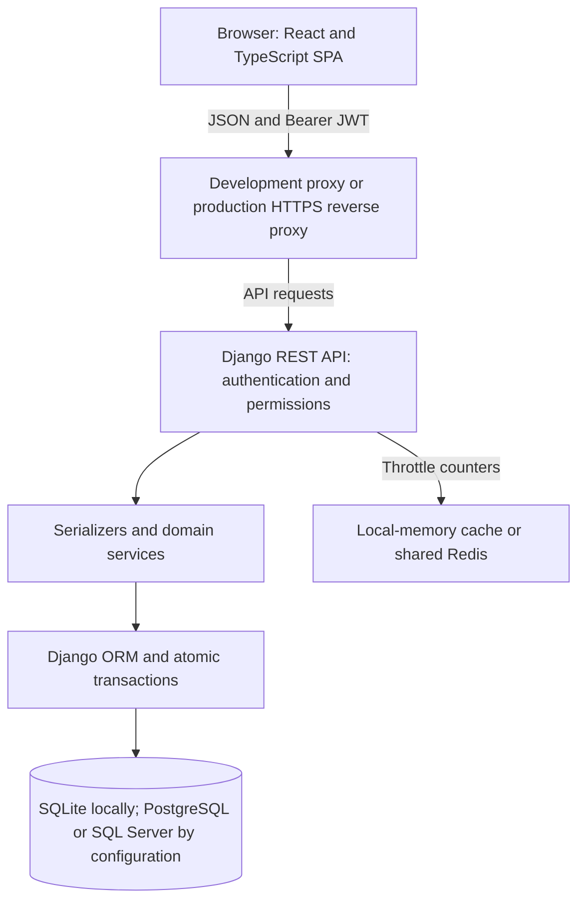
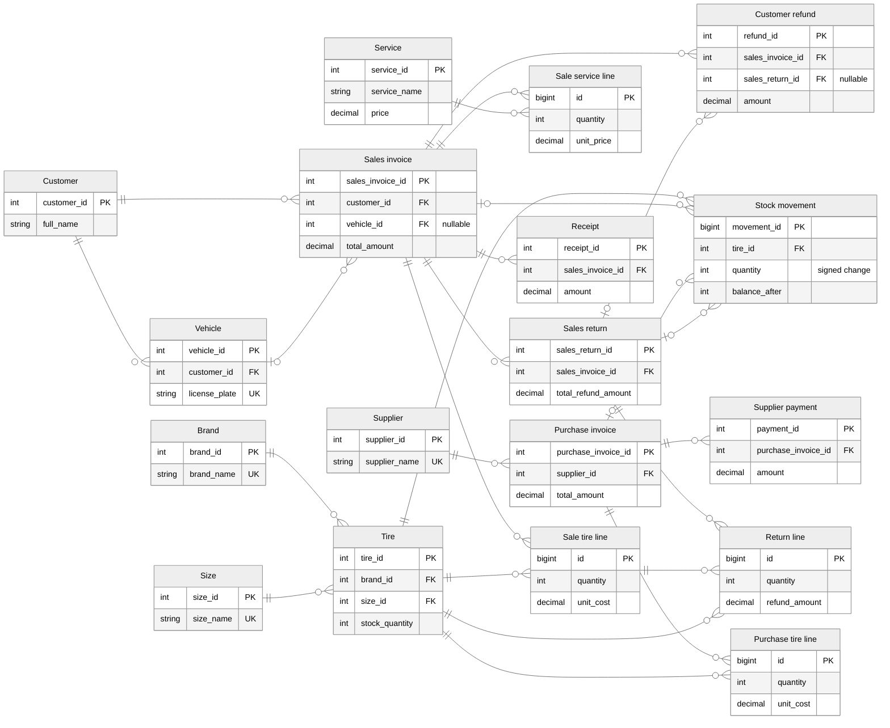

# Tire Shop Management System 🛞

**Inventory, workshop sales, purchasing, and payment tracking for tire retailers.**

[](https://www.python.org/)
[](https://www.djangoproject.com/)
[](https://www.typescriptlang.org/)
[](https://react.dev/)
[](https://vite.dev/)
[](https://tailwindcss.com/)
[](LICENSE)

A Django REST API and React/TypeScript application that connects customer and vehicle records with stock movements, sales and purchase documents, returns, and treasury vouchers. Designed around Persian-language shop workflows, with role-specific screens, Iranian license-plate handling, Jalali display dates, and rial/toman display preferences.

## Contents

- [Overview and features](#overview-and-features)
- [Architecture and technology](#architecture-and-technology)
- [Backend architecture](#backend-architecture)
- [Entity relationship diagram](#entity-relationship-diagram)
- [Authentication and authorization](#authentication-and-authorization)
- [REST API](#rest-api)
- [Frontend architecture](#frontend-architecture)
- [Getting started](#getting-started)
- [Environment variables](#environment-variables)
- [Testing and quality assurance](#testing-and-quality-assurance)
- [Deployment and operations](#deployment-and-operations)
- [Repository structure](#repository-structure)
- [Documentation](#documentation)
- [Contributing](#contributing)
- [License](#license)

## Overview and features

The application is intended for independent tire shops, tire retailers, and workshop teams that need a connected operational view instead of separate stock spreadsheets, customer notebooks, and payment logs. It is a **single-shop application**, not a multi-tenant SaaS platform.

| Business area | Implemented capabilities |
| --- | --- |
| Tire catalog | Brands, sizes, prices, stock levels, low-stock alerts, physical stock adjustments |
| Inventory history | Signed stock movements with resulting balances, source-document links, cost snapshots, and actors |
| Customer management | Customers, vehicles, Iranian license plates, normalized Persian/Arabic digits, customer-specific vehicle selection |
| Sales and workshop | Tire and service lines, fixed or percentage discounts, drafts and confirmation, server-generated invoice numbers |
| Procurement | Supplier records, purchase invoices, stock intake, purchase-cost updates, controlled cancellation |
| Returns | Returns linked to original sale lines, quantity ceilings, discount-aware refunds, stock restoration |
| Treasury | Receipts, supplier payments, customer refunds, payment references, partial settlement, cancellation reasons |
| Reporting | Daily KPIs, receivables, low-stock counts, brand sales, tire profitability, inventory value, date-range sales |
| Administration | Three application roles, manager-controlled user administration, Django admin, profile and password changes |
| Presentation | Responsive dashboard layout, dark/light theme, Persian/RTL default, English/LTR interface, rial/toman display |

**Scope boundaries:** vouchers record money received and paid in the shop rather than executing external bank transfers. Inventory movements track signed quantity changes and cost snapshots per transaction.

## Architecture and technology



Production reverse proxies, database servers, Redis instances, TLS termination, and process supervisors are configured as part of the deployment environment.

| Layer | Technology and responsibility |
| --- | --- |
| Backend runtime | Python; Django `>=5.2.17,<6.2` |
| API | Django REST Framework, django-filter, custom pagination/error handling |
| Persistence | Django ORM; SQLite default; PostgreSQL via psycopg; SQL Server via mssql-django/pyodbc |
| Identity | Custom Django user, SimpleJWT rotation/blacklisting, session authentication, application RBAC |
| API documentation | drf-spectacular OpenAPI, Swagger UI, Redoc |
| Caching | Django local-memory cache; optional Redis for shared cache/throttle state |
| Frontend | React 19, TypeScript 6, Vite 8, React Router 7 |
| State and HTTP | React Context/hooks and Axios; no Redux, Zustand, or query-cache framework |
| Styling and UI | Tailwind CSS 3, custom components, Lucide icons and native HTML charts |
| Quality tools | pytest/pytest-django, pytest-cov, Ruff, scoped strict mypy, Node test runner, TypeScript compiler, Oxlint |

Frontend versions are resolved in [`frontend/package-lock.json`](frontend/package-lock.json). Python dependencies are declared as bounded/minimum requirements in `backend/requirements*.txt` and resolved to exact versions in `backend/requirements*.lock` (generated with `uv pip compile`, not hash-pinned); audit and refresh the locks according to your release process.

## Backend architecture

### Domain modules

The backend is a modular Django application. HTTP views and serializers define transport contracts; service modules own multi-record inventory and financial workflows.

| App under `backend/apps/` | Responsibility |
| --- | --- |
| `accounts` | Custom user, roles, JWT endpoints, profiles, password changes, user administration |
| `customers` | Customers, vehicles, contact/plate validation and normalization |
| `catalog` | Brands, sizes, tires, stock movements, stock projection reconciliation |
| `services_app` | Workshop services and prices |
| `suppliers` | Supplier directory |
| `invoices` | Sales, purchases, line items, returns, document numbering and lifecycle services |
| `finance` | Receipt/payment/refund vouchers, settlement rules, payment reconciliation |
| `reports` | Read-only KPI and analytical service functions; views validate inputs and return responses; no business tables |

`backend/config/` contains settings, routing, and WSGI/ASGI entrypoints. `backend/utils/` contains shared exception handling, domain money/quantity validation, pagination, date/digit helpers, document protections, and database expressions.

### Data model and ORM patterns

- Customers own vehicles; sales reference a customer and optionally one of that customer's vehicles.
- Tires reference a brand and size. Sales and purchase documents own separate tire-line tables; sales also have service lines.
- Sales-return items reference the **original sales tire line**, not just a tire identifier.
- Receipts and refunds reference sales invoices; supplier payments reference purchase invoices.
- `InvoiceSequence` provides a per-document-type, per-Jalali-year counter. Example numbers are `S-1405-00001` and `P-1405-00001`.
- Most monetary columns are `DecimalField(14, 2)` in **IRR**, with a maximum of `999999999999.99`. Computed invoice totals are checked before committing.
- Sales tire lines retain unit-cost snapshots. Purchases retain the previous purchase price for eligible cancellation recovery; this is not FIFO accounting.
- Unique/check constraints, protected foreign keys, service validation, `transaction.atomic()`, row locks on supporting databases, and conditional stock updates protect relevant workflows. Related-object loading and aggregate/subquery annotations are used for list/report efficiency.
- `stock_quantity` is a current projection backed by stock-movement history. Projection repair has its own audit model; it is distinct from a physical stock adjustment.
- Invoice/voucher APIs prohibit direct editing/deletion and expose explicit lifecycle actions instead. These are application rules, not database-enforced append-only storage.

There is one configured `default` database connection, not a multi-database router. Some tables retain legacy explicit names, including `Tier` for tires. An unmanaged legacy invoice-item model is not used for current invoice workflows. See [database design](docs/DATABASE_DESIGN.md) for actual table names, relationships, and constraints.

### Important transactional flows

1. **Confirmed sale:** validate lines/ownership/discounts, lock tires, generate a number, create lines with cost snapshots, deduct stock, and record movements atomically. Drafts do not consume or reserve stock; confirmation performs stock-out.
2. **Purchase:** create document and lines, add stock, record movements, and update current purchase costs in one transaction.
3. **Settlement:** lock the invoice, enforce positive amounts and debt/refund ceilings, create a voucher, and synchronize payment status. Creating a positive `PAID` sale also creates its receipt atomically.
4. **Return:** enforce unreturned quantities, allocate original discounts, restore stock, and update balances. The API can create the resulting excess-payment refund voucher in the same workflow.
5. **Cancellation:** preserve the document and reverse the appropriate effects only when business constraints allow it. Active payments, existing returns, missing history, or insufficient stock can block cancellation.

SQLite is useful for local development but does not exercise production row-lock behavior or provide native fixed-point decimal arithmetic. Verify financial calculations and concurrent operations on the intended production database.

## Entity relationship diagram

The diagram follows the current Django foreign keys across catalog, sales, purchasing, returns and treasury. Boxes show selected stored columns; the connecting lines represent foreign keys. Money is stored in **IRR**. Display labels are shortened for readability; the [database guide](docs/DATABASE_DESIGN.md#model-to-table-map) maps models to physical tables, including the legacy `Tier` name for tires.



**Reading the diagram:** `||` means exactly one, `o|` / `|o` means zero or one, and `o{` means zero or more. A return line always points to its original sale tire line; a refund always belongs to a sales invoice and may also reference a return. Nullable source links allow opening stock and manual adjustments without an invoice. Cardinalities describe foreign keys, not every service-level validation rule.

User/audit references, the independent `InvoiceSequence` counter, stock-projection repair records, Django infrastructure and the unmanaged legacy model are omitted from this operational overview. Their actual fields and constraints are documented in [database design](docs/DATABASE_DESIGN.md).

## Authentication and authorization

- `POST /api/v1/auth/login/` returns an access token, refresh token, and user identity.
- Requests send `Authorization: Bearer <access_token>`. Default token lifetimes are **60 minutes** and **14 days**.
- Refresh tokens rotate; the old refresh token is blacklisted. Concurrent browser 401 responses share one refresh, and each failed request is replayed at most once.
- Logout verifies that the supplied refresh token belongs to the authenticated user before blacklisting it, and the frontend clears the browser session. **An already issued access token remains valid until expiry** unless separately revoked by the password-binding checks.
- Password changes invalidate password-bound tokens and blacklist outstanding refresh tokens.
- Django session authentication is also enabled. Session-authenticated writes require CSRF protection; Django admin uses the session flow.

| Role | Intended workflow |
| --- | --- |
| `MANAGER` | User administration, full shop operations, treasury, analytics, returns, cancellation |
| `WAREHOUSE` | Catalog maintenance, purchases, inventory history; read access to sales |
| `TECHNICIAN` | Customer/vehicle operations and sales creation; sales visibility limited to invoices they created |

Backend permissions and querysets enforce actual access; frontend guards are navigation aids. Permissions vary by endpoint, and most manager checks also allow Django superusers. For predictable SPA navigation, give administrators the `MANAGER` application role in addition to Django superuser status.

**Browser token security:** access and refresh tokens are stored in `localStorage`, not HttpOnly cookies. Malicious same-origin JavaScript can read them. Review XSS controls, scripts, and hosting security headers before exposure.

## REST API

Paths below include the `/api/v1/` prefix. Resource detail routes use their resource-specific primary key, which is not always named `id` in JSON.

| Method | Endpoint | Description | Auth required |
| --- | --- | --- | --- |
| POST | `/api/v1/auth/login/` | Obtain JWT pair and identity | No; login throttles apply |
| POST | `/api/v1/auth/token/refresh/` | Rotate refresh token and obtain access token | Valid refresh token |
| POST | `/api/v1/auth/logout/` | Blacklist submitted refresh token | Yes |
| GET / PATCH | `/api/v1/auth/profile/` | Read/update own permitted profile fields | Yes |
| POST | `/api/v1/auth/change-password/` | Change own password | Yes |
| GET / POST | `/api/v1/auth/users/` | List/create users | Manager |
| GET / POST | `/api/v1/crm/customers/` | List/create customers | Yes |
| GET / POST | `/api/v1/crm/vehicles/` | List/create vehicles; supports `?customer={id}` | Yes |
| GET / POST | `/api/v1/catalog/brands/`, `/sizes/`, `/tires/` | Catalog resources | Read: any user; write: manager/warehouse |
| GET | `/api/v1/catalog/tires/low-stock/` | Tires at/below alert threshold | Yes |
| POST | `/api/v1/catalog/tires/{id}/adjust-stock/` | Record a physical count and reason | Manager/warehouse |
| GET | `/api/v1/catalog/stock-movements/` | Read inventory movement history | Manager/warehouse |
| GET / POST | `/api/v1/workshop/services/` | Workshop service catalog | Read: any user; write: manager |
| GET / POST | `/api/v1/procurement/suppliers/` | Supplier directory | Read: any user; write: manager/warehouse |
| GET / POST | `/api/v1/invoices/sales/` | Sales list/creation | Read: visible invoices; create: manager/technician |
| POST | `/api/v1/invoices/sales/{id}/confirm/` | Confirm a visible draft | Manager/technician |
| POST | `/api/v1/invoices/sales/{id}/cancel/` | Cancel an eligible sale | Manager |
| GET / POST | `/api/v1/invoices/purchases/` | Purchase list/creation | Manager/warehouse |
| POST | `/api/v1/invoices/purchases/{id}/cancel/` | Cancel an eligible purchase | Manager |
| GET / POST | `/api/v1/invoices/returns/` | Sales-return documents | Manager |
| GET / POST | `/api/v1/treasury/receipts/`, `/payments/`, `/customer-refunds/` | Financial vouchers | Manager |
| POST | `/api/v1/treasury/{resource}/{id}/cancel/` | Cancel a voucher with a reason | Manager |
| GET | `/api/v1/analytics/dashboard-stats/` | Daily revenue, receivables, stock KPIs | Manager |
| GET | `/api/v1/analytics/sales-by-brand/`, `/profitability/`, `/inventory-value/`, `/sales-by-date/` | Analytical reports | Manager |

For grouped endpoints, abbreviated entries such as `/sizes/` and `/payments/` share the first entry's domain prefix. See the [API reference](docs/API_REFERENCE.md) for exact routes, detail operations, payload examples, permissions, and response shapes.

Additional routes:

| Route | Purpose | Access |
| --- | --- | --- |
| `/api/health/` | Database-connection health; HTTP 200 or 503 | Public |
| `/admin/` | Django administration | Staff login and Django permissions |
| `/api/schema/` | Generated OpenAPI schema | Public in debug; manager/superuser otherwise, unless explicitly overridden |
| `/api/docs/`, `/api/redoc/` | Swagger UI and Redoc | Same documentation policy |

Most list viewsets return `count`, `total_pages`, `current_page`, `next`, `previous`, and `results`. The default page size is 20; `?page_size=100` is the maximum request size. Selectors that need a complete dataset fetch every page. Analytics responses are not generally paginated.

Handled DRF exceptions use the following structure; explicit responses may instead contain `detail`:

```json
{
  "success": false,
  "status_code": 400,
  "errors": { "field_name": ["Validation message"] }
}
```

Model-backed decimal values usually serialize as strings; some computed monetary/report fields are JSON numbers. Follow field-specific contracts rather than assuming one representation for every amount.

## Frontend architecture

The frontend is a **client-rendered SPA**, with lazy-loaded route pages and no SSR implementation. Its UI prioritizes operational tables, searchable selectors, status labels, focused dialogs, and a persistent navigation/header layout.

```text
LanguageProvider
└── AuthProvider
    └── BrowserRouter / Suspense
        ├── Login
        └── RoleGuard
            └── MainLayout
                ├── Sidebar and header
                ├── Lazy-loaded pages
                └── Domain dialogs and shared controls
```

| Area | Implementation |
| --- | --- |
| Routing | `src/App.tsx`; nested authentication and role guards; role-specific landing pages |
| Session state | `AuthContext`; identity/profile validation, token storage, sign-in/out |
| Locale | `LanguageContext`, `src/utils/i18n.ts`, and `src/utils/englishMessages.ts`; Persian/English UI catalog and RTL/LTR direction |
| Design system and UI | [DESIGN.md](DESIGN.md); charcoal (`#202a35`) and amber (`#d18b23`) document-board tokens in `src/index.css` and `tailwind.config.js`, flat matte panels with dashed document seams, 244px charcoal rail / native `<dialog>` mobile drawer (`src/components/ui/Modal.tsx`), 620px horizontally scrollable mobile tables, custom HTML/CSS brand-sales bars, and A4 / 80mm thermal receipt print rules |
| Screen state | Local hooks for forms, filters, lists, dialogs, and loading/error states |
| API boundary | Domain modules under `src/api/`; shared Axios client, refresh queue, pagination helpers |
| Shared contracts | `src/types/`; nullable backend fields and distinct creation/read contracts |
| Utilities | Error-envelope parsing, request sequencing, plate/date/currency formatting, session helpers |

### Main routes and workflows

- **Manager:** `/dashboard`, `/reports`, `/treasury`, `/users`, plus operational screens.
- **Sales:** `/invoices/create` and `/invoices/sales`; choose a customer and vehicle, add tire/service lines, apply a discount, then create/confirm and settle an invoice.
- **Warehouse:** `/catalog/tires`, `/catalog/movements`, `/invoices/purchases`, `/suppliers`; receive stock, maintain catalog data, and investigate movement history.
- **Shared:** `/customers`; `/services` is exposed in the UI to managers/technicians, though API read access is broader.
- **Returns and receipts:** domain dialogs launched from invoice workflows; in-flight guards prevent repeated submissions while a request is pending. These guards are not server-side idempotency keys.

Persian/RTL is the default; English/LTR covers interface copy, forms, print layouts, statuses, currency formatting and dates. Shop-entered content and unknown custom server messages retain their original language. Backend values remain IRR: the currency preference changes display to rial/toman, not stored amounts. Vazirmatn is loaded through Google Fonts, which requires network access unless self-hosted. See the [frontend guide](frontend/README.md) for implementation and test boundaries.

## Getting started

### Prerequisites

- **Python 3.13 or 3.14**, latest patch recommended.
- **Node.js 22.18+**, with Node 24 LTS recommended, and npm. Native TypeScript test execution requires Node 22.18 or newer.
- Git and a terminal. SQLite needs no separate server.
- Optional: PostgreSQL or SQL Server for deployment testing, and Redis for shared cache state. SQL Server requires a native Microsoft ODBC driver; pip does not install it.

```bash
git clone https://github.com/Shayan-Nami/Tire-Shop-Management.git
cd Tire-Shop-Management
```

### Backend installation

```bash
cd backend
python -m venv venv
source venv/bin/activate

python -m pip install --upgrade pip
python -m pip install -r requirements.lock
cp .env.example .env
```

`requirements.lock` is the pinned runtime set for SQLite/PostgreSQL. **SQL Server users** (including Windows setups) install `requirements-mssql.lock` instead, which adds `pyodbc` and `mssql-django` to the runtime set. To pick up newer compatible versions, install `requirements.txt` / `requirements-mssql.txt` directly, and regenerate a lock after editing them with `uv pip compile requirements.txt --universal --python-version 3.14 -o requirements.lock` (for the SQL Server lock, pass both `requirements.txt requirements-mssql.txt` and `-o requirements-mssql.lock`).

On Windows PowerShell, activate the virtual environment with `.\venv\Scripts\Activate.ps1` (or `venv\Scripts\activate.bat` in `cmd.exe`) and copy the environment template with `copy .env.example .env`.

Review the copied file against the [environment reference](#environment-variables). The template intentionally leaves `DJANGO_SECRET_KEY` empty: generate a key with `python -c "import secrets; print(secrets.token_urlsafe(50))"` before starting. A minimal **local-only** `backend/.env` is:

```dotenv
DJANGO_DEBUG=True
DJANGO_SECRET_KEY=development-only-replace-with-a-random-key
ALLOWED_HOSTS=localhost,127.0.0.1
DB_ENGINE=sqlite
USE_SQL_SERVER=False
ALLOW_DEMO_SEED=False
```

Then initialize and start Django:

```bash
python manage.py check
python manage.py migrate
python manage.py createsuperuser
python manage.py runserver 127.0.0.1:8000
```

Sign in to `http://127.0.0.1:8000/admin/` with the new superuser, open that user record, and set its application role to **MANAGER** before using the SPA as a manager. The user model otherwise defaults to `TECHNICIAN`; Django superuser status alone does not change frontend role-based navigation.

### Frontend installation

In a second terminal, from the repository root:

```bash
cd frontend
cp .env.example .env
npm ci
npm run dev
```

On Windows PowerShell or `cmd.exe`, use `copy .env.example .env`. `npm ci` is recommended for reproducible installation from the committed lockfile. Use `npm install` when intentionally updating dependencies.

Open `http://localhost:5173`. Vite proxies `/api` to Django at `http://127.0.0.1:8000` by default. The dev server binds to `0.0.0.0`; restrict network access when using local/demo data. Sign in with the account created above.

### Optional demo data — disposable local databases only

Set **both** `DJANGO_DEBUG=True` and `ALLOW_DEMO_SEED=True` in `backend/.env`, then run:

```bash
python manage.py seed_tire_shop
```

The command creates sample records and known-password accounts if absent: `admin` / `admin123`, `technician` / `tech123`, and `warehouse` / `warehouse123`. Existing account passwords are preserved. **Never expose these credentials.** Disable demo seeding after use and rotate/delete seeded accounts before promoting any database; disabling the flag does not remove accounts.

## Environment variables

Backend settings load `backend/.env` through python-dotenv; existing process environment variables take precedence. Frontend configuration is loaded by Vite from `frontend/`.

Never commit active environment files or real credentials. Templates contain examples only. All `VITE_*` values must be treated as **public browser configuration**.

### Backend: core and database

| Variable | Default / accepted values | Purpose |
| --- | --- | --- |
| `DJANGO_DEBUG` | `False` | Enable local debugging explicitly; never enable for production |
| `DJANGO_SECRET_KEY` | Required outside debug | Unique random signing key; keys starting with `django-insecure-` are rejected in production. In debug without a key, a random per-process key is generated (sessions/tokens reset on restart) |
| `ALLOWED_HOSTS` | `localhost,127.0.0.1,testserver` | Comma-separated hostnames, without schemes |
| `ALLOW_DEMO_SEED` | `False` | Additional opt-in for guarded demo seeding |
| `DB_ENGINE` | Empty / SQLite fallback | `postgres` / `postgresql`, `mssql` / `sqlserver`, or SQLite fallback |
| `USE_SQL_SERVER` | `False` | Legacy SQL Server selector; PostgreSQL branch takes precedence |
| `DB_NAME` | PostgreSQL: `tire_shop_db`; SQL Server: `TireShopDB` | External database name; SQLite uses `backend/db.sqlite3` |
| `DB_USER` | PostgreSQL: `postgres`; SQL Server: empty | External database username |
| `DB_PASSWORD` | Empty | External database password; supply securely |
| `DB_HOST` | `localhost` | External database host |
| `DB_PORT` | PostgreSQL: `5432`; SQL Server: `1433` | Database port |
| `CONN_MAX_AGE` | `60` | Persistent database connection lifetime in seconds |
| `DB_DRIVER` | `ODBC Driver 17 for SQL Server` | Installed native ODBC driver name |
| `DB_TRUSTED_CONNECTION` | True when trimmed `DB_USER` is empty; false otherwise | SQL Server integrated authentication; explicit true ignores SQL username/password |
| `DB_ENCRYPT` | `yes` | SQL Server transport encryption |
| `DB_TRUST_SERVER_CERTIFICATE` | `no` | SQL Server certificate-validation bypass; leave off unless deliberately justified |

The last three controls accept trimmed, case-insensitive `true/false`, `yes/no`, or `1/0`; invalid values fail configuration in the SQL Server branch. **Migration impact:** SQL Server connections now default to encryption with certificate validation. Install a trusted certificate rather than hiding a trust failure. Supplying `DB_USER` selects SQL authentication unless explicitly overridden.

An unknown `DB_ENGINE` silently falls back to SQLite. Verify the actual selected backend before deploying; a healthy local SQLite connection does not prove external database configuration works.

### Backend: origins, sessions, caching, and hardening

| Variable | Default | Purpose |
| --- | --- | --- |
| `CORS_ALLOWED_ORIGINS` | localhost/127.0.0.1 on ports 3000 and 5173 | Comma-separated trusted browser origins; wildcard access is disabled |
| `CSRF_TRUSTED_ORIGINS` | Same development origins | Trusted origins for CSRF-protected session requests |
| `JWT_ACCESS_MINUTES` | `60` | Access-token lifetime |
| `JWT_REFRESH_DAYS` | `14` | Refresh-token lifetime |
| `REDIS_CACHE_URL` | Empty | Enable Django Redis cache; otherwise cache is process-local |
| `NUM_PROXIES` | `0` | Number of trusted proxy hops for DRF client-IP handling |
| `THROTTLE_ANON_RATE` / `THROTTLE_USER_RATE` | `30/minute` / `300/minute` | General API throttle rates |
| `THROTTLE_LOGIN_IP_RATE` / `THROTTLE_LOGIN_USER_RATE` | `5/minute` each | Login throttles by IP and username; also applied (separate counters) to POST `/admin/login/` |
| `THROTTLE_TOKEN_REFRESH_RATE` | `15/minute` | Refresh throttle |
| `SECURE_PROXY_SSL_HEADER` | `False` | Trust proxy-controlled `X-Forwarded-Proto: https` only when enabled |
| `SESSION_COOKIE_SECURE` / `CSRF_COOKIE_SECURE` | `True` unless `DJANGO_DEBUG=True` | Restrict cookies to HTTPS. Admin login over plain HTTP (LAN) requires setting both to `False` explicitly; blank means default |
| `SECURE_SSL_REDIRECT` | `False` | Redirect HTTP to HTTPS (opt-in; many shops run on plain-HTTP LANs) |
| `SECURE_HSTS_SECONDS` | `0` | HSTS duration; opt-in, effectively irreversible for browsers that saw it, so enable only after HTTPS is verified everywhere |
| `SECURE_HSTS_INCLUDE_SUBDOMAINS` / `SECURE_HSTS_PRELOAD` | `False` | Explicit HSTS policy decisions |
| `ENABLE_DOCS_IN_PROD` | `False` | Explicitly make API docs public outside debug; normally leave off |

`PAGINATION_PAGE_SIZE` is present in REST framework settings, but the current pagination class fixes its default at 20. Use the supported `page_size` request parameter (maximum 100); do not rely on this environment variable to change that default.

Generate a production key with `python -c "import secrets; print(secrets.token_urlsafe(50))"`. Store it through your deployment secret mechanism. Secure cookies are on by default outside debug, but HTTPS redirects, HSTS, proxy trust (`SECURE_PROXY_SSL_HEADER` with a matching `NUM_PROXIES`), and shared Redis are **not automatically configured** by installing this project; `python manage.py check --deploy` warns when proxy trust lacks `NUM_PROXIES` or the cache is process-local.

### Frontend

| Variable | Default | Purpose |
| --- | --- | --- |
| `VITE_API_BASE_URL` | `/api/v1` | API prefix/origin used by ordinary requests and token refresh; embedded at build time |
| `VITE_API_PROXY_TARGET` | `http://127.0.0.1:8000` | Destination for Vite's development `/api` proxy; no production routing effect |

Restart Vite after configuration changes; rebuild production assets when changing `VITE_API_BASE_URL`. A separate API origin also needs deliberate backend CORS/CSRF configuration. Keep the relative default for same-origin reverse-proxy hosting.

## Testing and quality assurance

### Backend

Run from `backend/` with the virtual environment active. The verification settings disable `.env` loading and use an in-memory SQLite database and a process-local cache, keeping the existing local database and external cache untouched:

```bash
python -m pip install -r requirements-dev.lock
python -m pip check
python manage.py check --settings=config.verification_settings
python manage.py makemigrations --check --dry-run --settings=config.verification_settings
python -m pytest --ds=config.verification_settings --cov=apps --cov=utils
python -m ruff check .
python -m mypy
python manage.py spectacular --settings=config.verification_settings --validate --fail-on-warn
```

The schema command validates and prints OpenAPI without overwriting the tracked `schema.yml`. The verification settings are for checks only; do not use them to serve the application. To inspect unapplied migrations for your configured development database, use `python manage.py migrate --plan`; back up valuable data before applying them.

pytest covers permissions/token security, model/serializer validation, stock history, invoice lifecycle, returns, financial reconciliation, and discount-aware reports. The suite is pytest-based; `python manage.py test` is not an equivalent discovery path for all tests. SQLite contention has a dedicated regression test; row-lock/backend-specific tests still skip under SQLite. Run those separately with the intended database settings and a dedicated PostgreSQL or SQL Server test database. Test fixtures clear the configured cache, so use a disposable cache when overriding the verification settings.

Ruff checks backend linting and unused imports, and mypy validates type annotations in `utils/domain.py`.

### Frontend

Run from `frontend/`:

```bash
npm ci
npm test
npm run typecheck
npm run lint
npm run build
npm audit
```

Tests use Node's native TypeScript support, mocked HTTP transport, and a lightweight hook-level TSX harness. They cover API pagination/contracts, refresh rotation/logout, duplicate-submission guards, error envelopes, selector races, plate normalization, language/English UI and print-label coverage, brand chart amounts, dashboard/report error recovery, workspace scroll reset, and invoice/catalog workflows.

## Deployment and operations

Before exposing the application:

1. Use a unique secret, `DJANGO_DEBUG=False`, explicit hosts/origins, and non-demo accounts.
2. Provision and verify the intended database, native drivers if needed, backups, and a restore procedure. Apply migrations after reviewing the plan.
3. Run `python manage.py check --deploy`; investigate HTTPS, cookie, HSTS, and proxy warnings rather than assuming defaults are hardened.
4. Build the SPA and serve `frontend/dist/` through static hosting with browser-history fallback. Route `/api/` and `/admin/` to Django; do not turn API failures into SPA HTML.
5. Run a supervised WSGI/ASGI server. Gunicorn is a non-Windows dependency; Django `runserver` and Vite dev/preview are not production servers.
6. Collect Django static assets, configure logging/rotation, and use shared Redis if throttle state must be shared across workers.
7. Exercise real login/refresh, roles, sales/purchases/returns, payments, cancellation, concurrency, and deep-link workflows on the target infrastructure.

`/api/health/` only checks opening a database connection. It does not check migrations, cache availability, or business integrity. `python manage.py reconcile_stock` and `python manage.py reconcile_payments` provide read-only discrepancy checks; stock repair requires explicit authorization/reason flags. See the [deployment and operations guide](docs/DEPLOYMENT_GUIDE.md) before repair operations.

## Repository structure

```text
Tire-Shop-Management/
|-- .github/workflows/ci.yml
|-- backend/
|   |-- apps/
|   |   |-- accounts/
|   |   |-- catalog/
|   |   |-- customers/
|   |   |-- finance/
|   |   |-- invoices/
|   |   |-- reports/
|   |   |-- services_app/
|   |   `-- suppliers/
|   |-- config/
|   |-- utils/
|   |-- .env.example
|   |-- conftest.py
|   |-- manage.py
|   |-- pyproject.toml
|   |-- pytest.ini
|   |-- requirements.txt, requirements.lock
|   |-- requirements-mssql.txt, requirements-mssql.lock
|   |-- requirements-dev.txt, requirements-dev.lock
|   `-- schema.yml
|-- frontend/
|   |-- public/
|   |-- src/
|   |   |-- api/
|   |   |-- components/
|   |   |-- context/
|   |   |-- pages/
|   |   |-- types/
|   |   `-- utils/
|   |-- tests/
|   |-- .env.example
|   |-- .oxlintrc.json
|   |-- index.html
|   |-- package.json
|   |-- package-lock.json
|   |-- postcss.config.js
|   |-- README.md
|   |-- tailwind.config.js
|   |-- tsconfig*.json
|   `-- vite.config.ts
|-- docs/
|   |-- API_REFERENCE.md
|   |-- ARCHITECTURE.md
|   |-- DATABASE_DESIGN.md
|   `-- DEPLOYMENT_GUIDE.md
|-- .gitattributes
|-- .gitignore
|-- DESIGN.md
|-- LICENSE
`-- README.md
```

Domain apps keep their models, serializers, views, tests, and migrations together as applicable. Local databases, active `.env` files, virtual environments, `node_modules`, logs, caches, IDE settings, and generated builds are intentionally excluded from version control. Use Django migrations to initialize the application database.

## Documentation

| Document | Contents |
| --- | --- |
| [Architecture](docs/ARCHITECTURE.md) | Module boundaries, transactional services, identity and storage decisions |
| [Database design](docs/DATABASE_DESIGN.md) | Actual model/table map, balance calculations, constraints, migration caveats |
| [API reference](docs/API_REFERENCE.md) | Routes, role policies, payloads, pagination, error formats |
| [Deployment and operations](docs/DEPLOYMENT_GUIDE.md) | Hardening, release checks, monitoring, reconciliation, recovery |
| [Frontend guide](frontend/README.md) | SPA structure, session handling, scripts, and testing |
| [Design system](DESIGN.md) | Interface tokens, components, layout and print rules |

## Contributing

1. Open an issue describing the problem, expected behavior, and reproduction steps. Do not include credentials, customer records, or production database dumps.
2. Create a focused branch such as `fix/invoice-total-validation`, `feat/service-filter`, or `docs/setup-guide`.
3. Keep business rules in the appropriate backend service and transport validation in serializers. Preserve atomicity, cost history, server permissions, and IRR conventions.
4. Keep frontend contracts aligned with serializers, including nullable fields, resource-specific IDs, pagination, and standardized errors.
5. Add regression tests for behavior changes. Include Django migrations for model changes and update related documentation/environment examples when configuration changes.
6. Run the applicable checks above. Submit a pull request describing the change, validation results, migration/deployment impact, and any remaining limitations.

Do not commit secrets, local databases, customer exports, generated assets, dependency folders, or IDE settings. Avoid unrelated refactors and broad dependency upgrades in a bug-fix pull request. The [GitHub Actions workflow](.github/workflows/ci.yml) runs on pushes and pull requests; require a successful hosted run before merging. It validates changes but does not deploy the application.

## License

Distributed under the **MIT License**. Copyright (c) 2026 Shayan-Nami. See [LICENSE](LICENSE) for the full terms.
